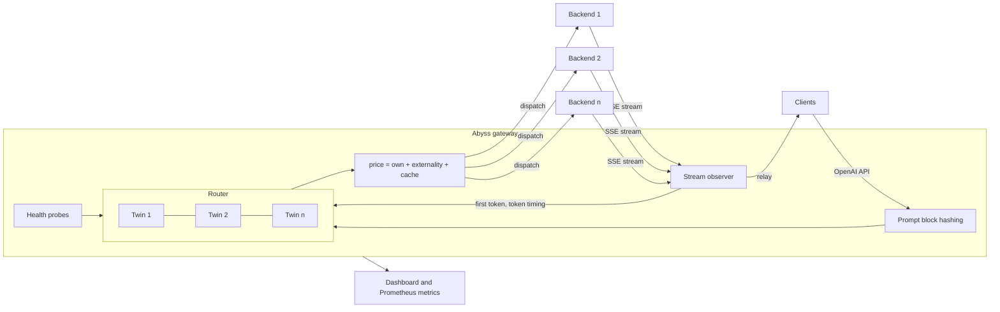
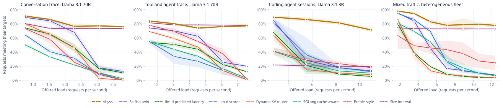
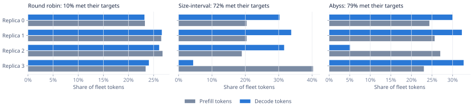
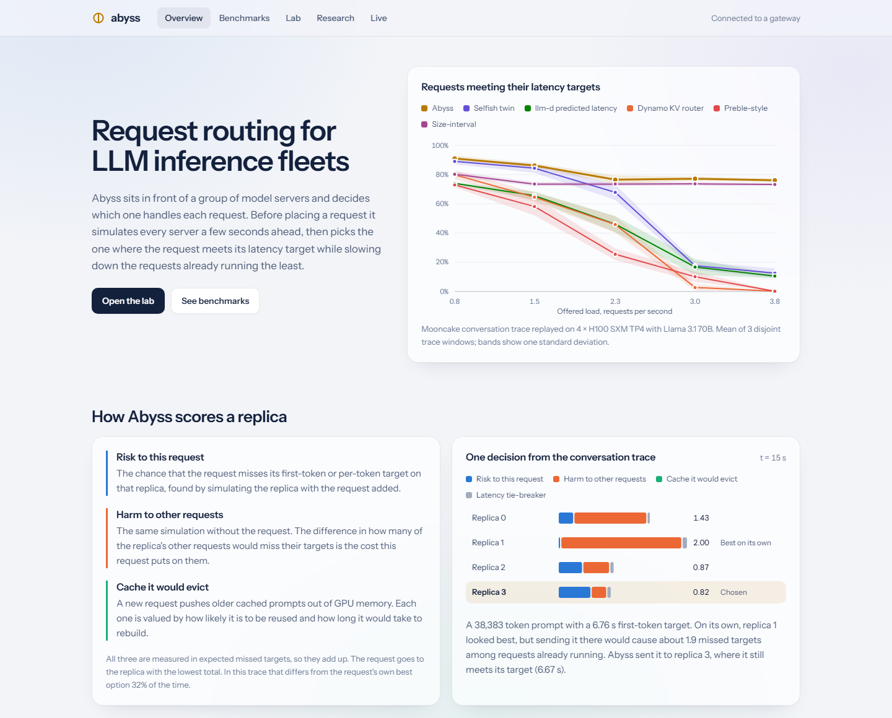
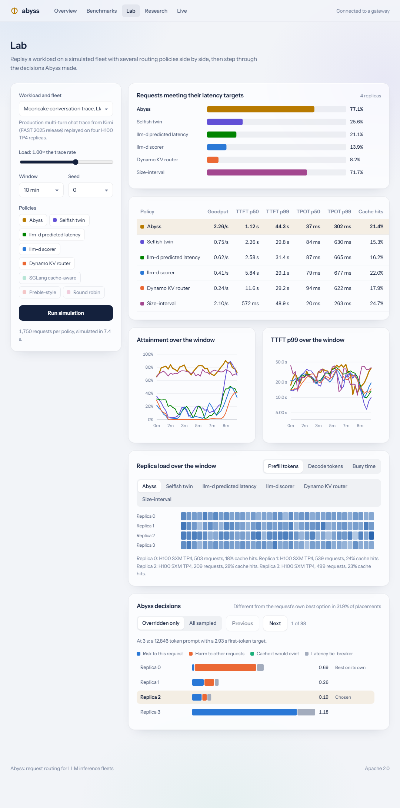
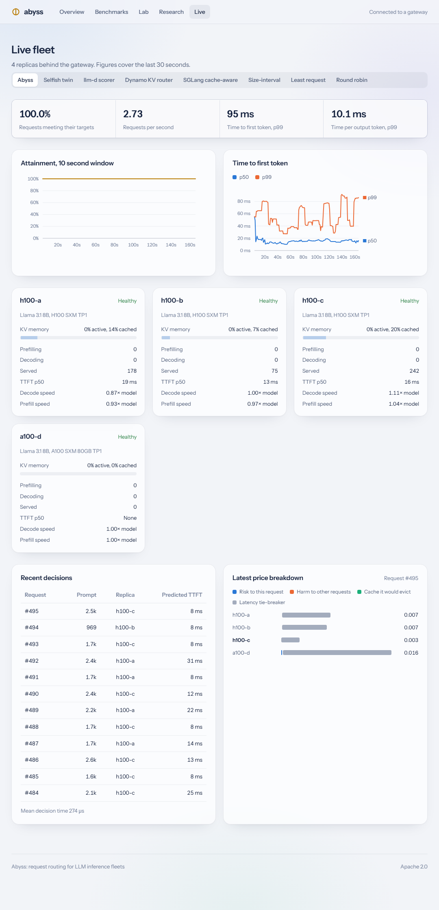

# Abyss

Abyss is an interference-aware request router for LLM inference fleets. For every incoming request and every candidate replica, it rolls a model of that replica's scheduler forward twice, once with the request and once without, and dispatches the request to the replica that minimizes the expected number of latency-objective misses across all requests: the new one, the ones already running there, and the future requests that depend on the prefix cache it would evict.

Abyss runs as an OpenAI-compatible gateway in front of vLLM, SGLang or any compatible server and requires no changes to the servers. The repository also contains the discrete-event fleet simulator, the baseline routers and the scripts used for the evaluation below. All reported results come from that simulator.

## Architecture



Each twin is a step-level model of a vLLM V1 engine: continuous batching with chunked prefill, paged KV memory, an LRU prefix cache and a roofline step-time model of the backend's model and accelerator. Twins are synchronized with the token streams the gateway relays and learn separate prefill and decode speed scales online, so a backend that runs faster or slower than its nominal model is tracked without instrumentation.

## Scoring rule

Request $j$ has a time-to-first-token objective $T_j$ and a time-per-output-token objective $P_j$, and $M_j \in \lbrace 0, 1 \rbrace$ indicates a miss of either. The fleet objective is

```math
\min_{\pi}\; \mathbb{E}\Big[\sum_j w_j M_j\Big].
```

For request $q$, Abyss selects

```math
r^\star(q) = \arg\min_r \Big( \underbrace{w_q\,\mathbb{E}[M_q \mid s_r \oplus q]}_{\text{own risk}}
+ \underbrace{\sum_{j \in s_r} w_j \big(\mathbb{E}[M_j \mid s_r \oplus q] - \mathbb{E}[M_j \mid s_r]\big)}_{\text{externality}}
+ \underbrace{K_r(q)}_{\text{cache}} \Big),
```

where $s_r \oplus q$ is replica $r$'s state with $q$ added and $K_r(q)$ is the expected rebuild cost of the prefix-cache blocks $q$ would evict. Predicted latencies $x$ become miss probabilities through a lognormal error model whose spread $\sigma$ each twin measures online:

```math
\hat P(x;\, s, \sigma) = \Phi\!\left(\frac{\ln x - \ln s}{\sqrt{\sigma^2 + \sigma_0^2}}\right).
```

The middle term is the marginal-cost toll of congestion pricing (Pigou, 1920; Beckmann, McGuire and Winsten, 1956), applied per request and per replica. Placing $q$ on $r$ changes only replica $r$'s expected misses, so minimizing the sum is the one-step greedy policy for the fleet objective. [docs/theory.md](docs/theory.md) gives the derivation and every estimator, and [docs/design.md](docs/design.md) describes the engine, performance and gateway models.

## Results

<p align="center">
  
</p>

The figure shows the share of requests that meet both latency objectives as offered load grows, averaged over three independent runs, with bands of one standard deviation. All policies see the same requests, the same replicas and the same hidden per-replica speed variation. No policy knows response lengths in advance, and clients abandon requests that wait too long. The competing routers are reimplemented from their public documentation. The Mooncake traces are production traces from Moonshot AI's Kimi service.

Loads are multiples of a reference rate: each trace's own arrival rate replayed on the fleet shown, or the generator rate for the synthetic workloads. Fleet sizes are choices of this evaluation. At the reference rate, with every baseline's parameters tuned on one trace window and all policies compared on two windows the tuning did not see:

<!-- results-table -->
| Workload | Fleet | Abyss | Best existing router | Size-interval heuristic | Abyss, by prompt tokens | Heuristic, by prompt tokens |
|---|---|---|---|---|---|---|
| Mooncake conversation trace, Llama 3.1 70B | 4 × H100 TP4 | **76.4%** | 14.0% (llm-d predicted latency) | 74.4% (default settings) | **57.9%** | 38.5% |
| Mooncake tool and agent trace, Llama 3.1 70B | 4 × H100 TP4 | 76.3% | 41.7% (Preble-style) | **77.3%** (default settings) | **61.6%** | 54.3% |
| Coding agent sessions, Llama 3.1 8B | 8 × H100 | **72.6%** | 19.0% (Preble-style) | 65.9% (40k cutoff, 1 long replica) | **60.2%** | 44.5% |
| Chat, agent and RAG mix, Qwen3 32B | 2 × H100 TP2, 2 × A100 TP2, 2 × L40S TP4 | 76.3% | 49.0% (Preble-style) | **84.2%** (32k cutoff, 1 long replica) | 34.9% | **43.2%** |
<!-- /results-table -->

<!-- headline -->Against the best existing router on each workload, Abyss is ahead by 27 to 62 points at the reference rate. The strongest alternative is the size-interval heuristic, which sends every prompt above a length cutoff to dedicated replicas: Abyss is ahead by 2 points on the conversation trace, behind by 1 point on the tool and agent trace, ahead by 7 points on the coding agent sessions and behind by 8 points on the mixed-GPU fleet. The heuristic gives up on nearly every prompt above its cutoff; weighted by prompt tokens, Abyss is ahead of it on three of four workloads (the conversation trace, the tool and agent trace and the coding agent sessions).<!-- /headline --> <!-- low-load -->With spare capacity the fixed cutoff is a handicap. At 0.25× the reference rate Abyss meets both objectives for 84% to 98% of requests, the size-interval heuristic with default parameters for 22% to 82%, and the best other policy for 78% to 95%.<!-- /low-load -->

<!-- capacity -->Measured as the highest load at which at least 80% of requests meet both objectives, Abyss sustains 0.66× (2.02 req/s) against 0.57× (1.73 req/s) for the selfish twin on the conversation trace; 0.51× (3.11 req/s) against 0.38× (2.30 req/s) for the size-interval heuristic on the tool and agent trace; 0.79× (8.64 req/s) against 0.27× (2.97 req/s) for the selfish twin on the coding agent sessions; 0.90× (6.37 req/s) against 0.59× (4.18 req/s) for the llm-d scorer on the mixed-GPU fleet. Loads are multiples of the reference rate, interpolated between the tested levels.<!-- /capacity -->

<!-- sensitivity -->The comparison depends on the latency objectives. Across six variants of the objectives on the two production traces at the reference rate, Abyss's difference from the best existing router ranges from +30 to +65 points, and from the best size-interval setting from -7 to +7 points.<!-- /sensitivity --> <!-- mismatch -->Abyss's replica model is the same code as the simulated servers. When the servers' real prefill or decode speed departs from the model in ways a single speed factor cannot absorb, Abyss's attainment on the conversation trace at the reference rate ranges from 67.8% to 80.2% (77.2% with an exact model), its median TTFT prediction error stays between 13% and 15%, and its difference from the size-interval heuristic ranges from -1 to +5 points.<!-- /mismatch -->

<!-- ablation -->The second cost does most of the work: removing it drops Abyss from 77.2% to 17.4% on the conversation trace.<!-- /ablation --> Ranking replicas by the request's own predicted latency alone works at light load but degrades near capacity, because requests that each prefer the same cached replica are placed on it together.

<!-- roles -->Abyss ends up giving replicas different jobs without being told to. In the first conversation window at the reference rate, one replica handles 27% of the prompt processing but only 5% of the token generation, so the others can stream responses with fewer interruptions. The size-interval heuristic imposes a similar split by rule.<!-- /roles -->

<p align="center">
  
</p>

<!-- fairness -->The trade-off is that the longest prompts (over 64k tokens, 3% of the conversation trace) meet their targets 4% of the time under Abyss at the reference rate, against 20% for the llm-d scorer.<!-- /fairness --> The `X-Abyss-Weight` request header sets $w_j$ and lets operators protect such requests. The full method, tuned baselines, ablations, robustness to model error and limitations are in [docs/evaluation.md](docs/evaluation.md).

## Dashboard

`abyss studio` and `abyss gateway` serve a dashboard with the benchmark results, a lab for running simulations and stepping through individual routing decisions, and a live view of the replicas behind a running gateway.

<p align="center">
  
</p>

<p align="center">
  
  
</p>

## Quick start

Requires Go 1.22 or newer. Node 20 or newer is needed only to rebuild the dashboard, which ships prebuilt.

```sh
git clone https://github.com/Rishi0507/Abyss-Interference-aware-routing-for-LLM-inference.git abyss
cd abyss
make build
sh scripts/fetch-traces.sh
./abyss sim --preset conversation-70b --scale 1
./abyss studio
```

`make build` produces `./abyss` with the dashboard embedded, `scripts/fetch-traces.sh` downloads the public Mooncake traces into `traces/`, and `abyss studio` serves the dashboard at `http://localhost:8090`.

To run the gateway against emulated servers on one machine, with two of them slower or faster than their model:

```sh
./abyss emulate --listen :9001 --bias 1.15 &
./abyss emulate --listen :9002 &
./abyss emulate --listen :9003 --bias 0.9 &
./abyss emulate --listen :9004 --hardware a100 &
./abyss gateway --config configs/gateway.json
./abyss loadgen --target http://localhost:8080 --workload chat --rate 6 --duration 120
```

The Live page at `http://localhost:8080` shows each replica's learned speed scales. Within one to two minutes the first replica converges to a decode speed of about 0.87× its model and the third to about 1.1×. The prefill scale moves only when prompts are long enough to time. The routing policy can be changed from the page or with `curl -X POST localhost:8080/api/live/policy -d '{"policy":"llm-d"}'`.

To route to real servers, list them in `configs/gateway.json` with their model and accelerator:

```json
{
  "listen": ":8080",
  "policy": "abyss",
  "slo": { "ttft_base_s": 1.0, "ttft_per_ktok_s": 0.15, "tpot_s": 0.08 },
  "backends": [
    { "name": "node-a", "url": "http://10.0.0.11:8000", "model": "llama-3.1-70b", "hardware": "h100", "tp": 4, "scrape_metrics": true },
    { "name": "node-b", "url": "http://10.0.0.12:8000", "model": "llama-3.1-70b", "hardware": "h100", "tp": 4, "scrape_metrics": true }
  ]
}
```

## Calibration

Replica models start from published accelerator specifications. `abyss calibrate` measures an OpenAI-compatible server and fits the performance model to it:

```sh
./abyss calibrate --target http://10.0.0.11:8000 --model llama-3.1-70b --hardware h100 --tp 4 --out node-a.json
```

The `efficiency` object in the output goes into that backend's entry in the gateway configuration. Against an emulated server configured 30% slower than its model, calibration reduced the median timing error from about 25% to under 2%. `scripts/gpu/` contains the procedure for repeating the comparison on vLLM servers.

## Reproducing the results

```sh
sh scripts/reproduce.sh
python scripts/report.py
python scripts/build_paper.py
```

`reproduce.sh` runs the main sweeps, ablations, baseline tuning, robustness and sensitivity runs, the scaling study, the decision-time benchmark and the figures. `report.py` regenerates [docs/evaluation.md](docs/evaluation.md) and the results in this file from `results/`, and `build_paper.py` regenerates the paper. The simulator is deterministic for a given binary, configuration and seed. The full set takes about 75 minutes on a two-core laptop.

| Command | Purpose |
|---|---|
| `abyss catalog` | Models, accelerators, workloads and routing policies |
| `abyss trace --preset NAME` | Workload statistics and replica capacity |
| `abyss sim --preset NAME --scale X -v` | One traffic level, every policy, per-replica breakdown |
| `abyss bench --preset NAME --seeds 3` | Full sweep written to `results/NAME.json` |
| `abyss tune --preset NAME` | Grid search of baseline parameters on one window, evaluation on held-out windows |
| `abyss bench --preset NAME --hidden-gemm 0.73` | Rerun with a model error unknown to the router (also `--hidden-attention`, `--hidden-bandwidth`) |
| `abyss calibrate --target URL` | Fit the performance model to a real server |

## Routing policies

| Name | Behavior |
|---|---|
| `abyss` | Own risk, externality and cache cost (default) |
| `abyss-selfish` | Same replica twins, own risk only |
| `llm-d-predicted` | Decision rule of llm-d's predicted-latency scheduler (affinity gate, best-fit headroom), with Abyss's twins as the predictor |
| `preble` | Preble-style exploit or explore: longest cached match when it covers most of the prompt, otherwise lowest recent load plus prefill cost |
| `llm-d` | Weighted prefix match, queue length and memory use (3, 2, 2) with exact cache knowledge |
| `dynamo` | `prefill_blocks + active_blocks`, lowest wins |
| `sglang` | Approximate prefix tree per server, shortest queue when load is uneven |
| `sita` | Size-interval assignment: prompts above a length cutoff go to a dedicated pool, least outstanding work inside each pool |
| `least-work` | Replica with the least outstanding prefill work, counting cached tokens |
| `chwbl` | Consistent hashing on the prompt prefix with a load bound |
| `least-request`, `p2c`, `round-robin`, `random` | Classic load balancers |

Parameters can be set inline, for example `llm-d:8,2,0`, `dynamo:4`, `sglang:0.3,64,1.5`, `chwbl:1.25` or `sita:32768,1` (cutoff in tokens, replicas in the long pool). Ablation variants: `abyss-no-interference`, `abyss-no-cache`, `abyss-oracle` (true response lengths), `abyss-late-binding`, `abyss-shed` (rejects requests predicted to miss by a wide margin) and `abyss-k8` (prices a shortlist of 8 replicas).

## Limitations

- Results come from simulation. The engine and step-time models follow vLLM V1 scheduling and published accelerator specifications; the procedure in `scripts/gpu/` for validating them on GPUs has not yet been run.
- Abyss's twin and the simulated servers share code, so structural differences between the twin and a real engine are not represented. The robustness section of the evaluation covers speed errors.
- Baselines are reimplementations from public documentation, evaluated with default and held-out tuned parameters.
- The objective counts requests, which favors short requests over long ones, as the per-length tables in the evaluation show.

## Documentation

- [Paper (PDF)](paper/abyss-paper.pdf): the full write-up, generated from the results in this repository.
- [Theory](docs/theory.md): problem statement, marginal-cost placement, estimators and online calibration.
- [Design](docs/design.md): engine model, performance model, twins, gateway and observability of each policy.
- [Evaluation](docs/evaluation.md): method, workloads, full results, sustained load, tuned baselines, sensitivity, ablations, robustness, scaling and limitations.
- [Operations](docs/operations.md): configuration, HTTP API, metrics, calibration and tuning.

## Repository layout

| Path | Contents |
|---|---|
| `cmd/abyss` | Command line entry point |
| `internal/perf` | Model and accelerator catalog, step-time model |
| `internal/engine` | vLLM-style engine model: scheduler, paged KV memory, prefix cache, forks |
| `internal/policy` | Abyss and the baseline routing policies |
| `internal/cluster` | Discrete-event fleet simulator |
| `internal/experiment` | Sweeps, aggregation and baseline tuning |
| `internal/calibrate` | Measurement and fitting against real servers |
| `internal/workload` | Mooncake trace loader and synthetic workloads |
| `internal/gateway` | OpenAI-compatible gateway |
| `internal/emulator` | Emulated inference server |
| `internal/loadgen` | HTTP load generator |
| `internal/server` | Dashboard API |
| `web` | Dashboard source (React, TypeScript) |
| `scripts` | Experiment, report, figure and paper generators; GPU procedure |
| `paper` | Generated paper |
| `results` | Benchmark outputs used in this document |

## License

Apache 2.0. The Mooncake traces are published by their authors under their own terms and are downloaded separately.
