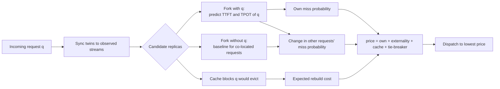
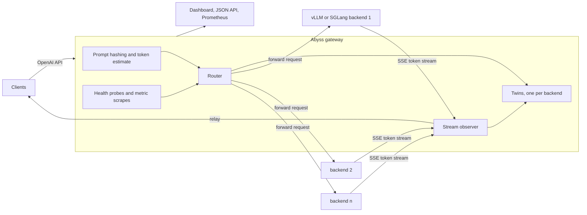

# Design

This document describes how Abyss models a replica, how it prices a placement, and how the gateway keeps its models consistent with real servers. Section 6 lists what each policy is allowed to observe, which matters as much as the algorithms when comparing them. The derivations behind the scoring rule and their sources are in [theory.md](theory.md). Bracketed numbers refer to the references at the end of this document.

## 1. The problem

A fleet of model servers sits behind a router. Each server runs continuous batching with chunked prefill, keeps a paged KV cache and reuses cached prefixes across requests. The router sees one request at a time and must commit it to a server.

The production routers compared in this repository score candidates from the request's own point of view. The llm-d inference scheduler combines a prefix-match score with queue length and KV utilization. The Dynamo KV router minimizes $w \cdot \mathrm{prefill\_blocks} + \mathrm{active\_blocks}$. The SGLang router follows its approximate radix tree unless load is imbalanced. Predicted-latency schedulers model the request's own TTFT and TPOT and pick the replica with the best headroom.

None of these scores includes the cost a placement imposes on the requests already on a replica. Three effects dominate in LLM serving:

- **Prefill interference.** With chunked prefill [3], a step that carries a prefill chunk takes as long as the chunk's compute, and every decode stream in that batch waits for it. A 60k-token prompt on a 70B model at an 8192-token budget occupies about eight consecutive steps of roughly 0.6 s.
- **Memory pressure.** New KV blocks evict the least recently used cached prefixes, and when the pool is exhausted the scheduler preempts running requests and recomputes them later.
- **Queueing.** Requests that arrive later wait for the new request's service time.

Routing that ignores these costs is the setting of Pigou's 1920 example [1] and of the price of anarchy literature. The standard remedy is a Pigouvian toll that charges each user the marginal cost it imposes on others. Abyss computes that toll per request and per candidate replica, using a model of each replica.



## 2. Engine model

`internal/engine` is a step-level model of a vLLM V1 style engine [2]. It is used in three ways: as the ground-truth replica in the simulator, as the router-side twin of each replica, and as a cheap fork for what-if rollouts.

### Scheduling

Each step has a token budget $B$ (`max_num_batched_tokens`, 8192 by default) and a sequence limit (`max_num_seqs`, 256). Running requests are scheduled first in admission order: a decoding request takes one token, and a request still in prefill takes $\min(\text{remaining}, \text{budget left})$ tokens. If a running request cannot get the pages it needs, the scheduler preempts from the tail of the running list, frees the victim's memory and returns it to the front of the waiting queue, where its prompt and generated tokens are recomputed. Waiting requests are admitted in FCFS order only if no preemption happened in the step and only if their first chunk fits.

### Prefix cache

Prompts are identified by chained block hashes, so equal hashes at position $i$ imply equal content up to block $i$. On admission the scheduler matches full blocks, capped so that at least one prompt token is computed. Blocks become cacheable as a request's KV crosses block boundaries, and a block computed concurrently by two requests is deduplicated. When a request finishes, its blocks are released in reverse order to the tail of an LRU free list, so the deepest blocks of a prefix are evicted first.

### Host offload

Blocks evicted from HBM can move to a host DRAM tier with its own LRU. A request whose prefix continues in host memory loads those blocks over PCIe instead of recomputing them, and the transfer time is charged to the step.

### Memory accounting

Memory is tracked in 16-token pages, following PagedAttention [2]. A request owns pages for its private tokens, and cached blocks own their pages until evicted. Each token stores one key and one value vector per layer and KV head [7], so for a model with $L$ layers, $H_{kv}$ KV heads of dimension $d_h$ and $b_{kv}$ bytes per element, deployed with tensor parallelism $\mathrm{TP}$ on accelerators with $M$ bytes of memory at utilization $u$, weights $W$ and reserve $R$:

```math
\mathrm{KV}_{\mathrm{tokens}} = \left\lfloor \frac{M u - W/\mathrm{TP} - R}{2 L \left\lceil H_{kv}/\mathrm{TP} \right\rceil d_h\, b_{kv}} \right\rfloor .
```

This gives about 412k tokens for Llama 3.1 70B on four H100s.

### Forks

`Fork.From` copies the running and waiting lists into a reusable buffer and replaces the block-level cache with a page counter, with each waiting request's cache hit precomputed against the source cache. A fork runs the same scheduler code, so rollouts and the full model cannot drift apart. Hit lookups are memoized against a cache epoch, so repeated forks within one decision do not rescan prompts.

## 3. Performance model

`internal/perf` predicts the duration of one engine step from its composition with a roofline model [4]: a step takes the longer of its compute time and its memory traffic time, plus communication and fixed overheads. A batch has $N$ scheduled tokens, $S$ sampled tokens, $Q$ sequences, attention pairs $A$ and KV reads $K$ over chunks of $q_i$ new tokens on context $c_i$:

```math
A = \sum_i q_i \left(c_i + \frac{q_i + 1}{2}\right), \qquad K = \sum_i (c_i + q_i).
```

With $P_{\mathrm{act}}$ active parameters per token, hidden size $d$, vocabulary $V$, $H$ attention heads, dense BF16 throughput $F$, HBM bandwidth $\beta$, link bandwidth $\beta_{\mathrm{link}}$ and link latency $\lambda_{\mathrm{link}}$ per accelerator:

```math
t_{\mathrm{compute}} = \frac{2 P_{\mathrm{act}} N + 2 d V S}{\mathrm{TP}\, F\, e_{\mathrm{gemm}}(N)} + \frac{4 L H d_h A}{\mathrm{TP}\, F\, e_{\mathrm{attn}}}, \qquad
e_{\mathrm{gemm}}(N) = e_g \frac{N}{N + 96},
```

```math
t_{\mathrm{memory}} = \frac{W_{\mathrm{dense}} + W_{\mathrm{expert}}\left(1 - (1 - k/E)^{N}\right) + (K + N)\, \kappa_{\mathrm{tok}}}{\beta\, e_{\mathrm{bw}}},
```

```math
t_{\mathrm{comm}} = 2L \left( \frac{2(\mathrm{TP} - 1)}{\mathrm{TP}} \cdot \frac{2 N d}{\beta_{\mathrm{link}}} + \lambda_{\mathrm{link}} \right) \quad (\mathrm{TP} > 1),
```

```math
t_{\mathrm{step}} = \max(t_{\mathrm{compute}},\, t_{\mathrm{memory}}) + t_{\mathrm{comm}} + t_{\mathrm{host}} + t_0 + t_{\mathrm{seq}}\, Q ,
```

where weights and KV bytes $\kappa_{\mathrm{tok}}$ are per GPU. The terms come from the following sources:

- $2 P_{\mathrm{act}}$ FLOPs per token for the linear layers follows the forward-pass estimate of Kaplan et al. [5], and $4 L H d_h$ FLOPs per query-key pair for attention (logits and value reduction) follows the accounting of Hoffmann et al. [6, Appendix F].
- The memory term, in which a decode step reads all weights once plus the KV cache of every sequence, follows the inference analysis of Pope et al. [7].
- The communication term counts two all-reduces per layer under tensor parallelism [8], each moving $2(\mathrm{TP} - 1)/\mathrm{TP}$ times the message size with a ring all-reduce [9].
- The MoE term is the expected fraction of experts touched by $N$ tokens when each token activates $k$ of $E$ experts [10], assuming uniform and independent routing. This assumption, the saturating GEMM efficiency $e_{\mathrm{gemm}}(N)$ and the per-step and per-sequence overheads are modeling choices of this work.

Default efficiencies are $e_g = 0.62$, $e_{\mathrm{attn}} = 0.42$, $e_{\mathrm{bw}} = 0.80$ and $t_0 = 1.8$ ms. They give about 0.59 s to prefill 8k tokens of Llama 3.1 70B on four H100s and about 21 ms for a 32-sequence decode step of Llama 3.1 8B at 8k context.

The catalog covers Llama 3.1 8B and 70B (BF16 and FP8), Qwen3 32B, Qwen3 30B A3B and Mixtral 8x7B on H100, H200, B200, A100, L40S and MI300X.

## 4. Twins

Abyss keeps one twin per backend: an engine instance with the nominal performance model of that backend, fed with exactly the requests the router dispatched there. The twin does not know output lengths, so its requests never finish on their own.

### Synchronization

Before each decision the twin advances its clock to the current time and reconciles with what the gateway has observed on the response streams:

| Observation | Twin action |
|---|---|
| First token arrived | If the twin still has the request queued or in prefill, complete its prefill and move it to decode |
| $n$ tokens streamed | Advance the request to $n$ generated tokens and grow its KV |
| No first token yet, twin already decoding | Hold the request one token short of finishing prefill |
| Stream finished | Remove the request and release its memory |

### Calibration

Real replicas are faster or slower than any nominal model, and not necessarily by the same factor for prefill and decode: attention kernels and clocks move prefill time, while memory bandwidth moves decode time. The twin therefore keeps a decode scale $\kappa_d$ and a prefill scale $\kappa_p$ and applies them to the two parts of every simulated step:

```math
\hat t_{\mathrm{step}} = \kappa_d\, t_{\mathrm{decode\ only}} + \kappa_p \left(t_{\mathrm{step}} - t_{\mathrm{decode\ only}}\right).
```

$\kappa_d$ is fitted to the inter-token gaps observed across decoding streams, and $\kappa_p$ to the time from dispatch to first token compared with the twin's own simulation. This split and the update rules in section 5.7 of [theory.md](theory.md) are modeling choices of this work. The live view and the `abyss_twin_speed_scale` and `abyss_twin_prefill_scale` metrics show both scales.

### Uncertainty

Each twin tracks the root mean square of the log error of its TTFT and TPOT predictions, measured when the real first token and the real completion arrive. That spread, combined with a floor of 0.12, is the $\sigma$ used to turn predictions into probabilities.

## 5. Pricing a placement

For request $q$ and backend $r$, the price is

```math
\mathrm{price}_r(q) = \mathrm{own}_r(q) + \mathrm{ext}_r(q) + K_r(q) + 0.05\, D_r(q).
```

- **Own risk.** Fork the twin, inject $q$, and step until $q$ emits its first token or a horizon of three times its TTFT objective passes. Continue for 24 steps to measure the step time $q$ will see and blend it with a long-run estimate. Convert both predictions into a miss probability with a lognormal error model.
- **Externality.** Fork the twin again without $q$ and step it to the time $q$ received its first token in the first fork. For each request already on the replica, convert the difference between the forks (a later first token, fewer tokens produced, slower decode steps for the rest of $q$'s life) into a change in that request's miss probability. The sum is the externality. A request that misses anyway contributes nothing, and a request close to its deadline contributes the most.
- **Cache.** If $q$'s new blocks and expected output do not fit in the free pages, the blocks at the head of the LRU list are evicted. Each is valued as its estimated reuse probability times its prefill rebuild time.
- **Tie-breaker.** $D_r(q)$ is the predicted latency of $q$ and the delay imposed on others, normalized by their objectives. It keeps latencies low when every probability is near zero.

The exact estimators are in section 5 of [theory.md](theory.md). Each miss probability can be multiplied by a per-request weight, set with the `X-Abyss-Weight` header at the gateway, which lets an operator protect a class of requests without changing the rule. Expected output length is the mean residual life of the last 4096 completions, capped by `max_tokens`.

### Cost

Each decision runs two forks per candidate, so its cost grows linearly with fleet size. Two options bound it: candidates can be priced in parallel, one goroutine per replica, with results identical to serial pricing; and a shortlist mode prices only the $k$ replicas with the lowest estimated backlog plus the replica with the longest cached prefix. Measured decision times are in the evaluation document.

## 6. What each policy can observe

A comparison is only meaningful if no policy sees something it could not see in production.

| Signal | Abyss | Selfish twin | llm-d predicted | llm-d | Dynamo | SGLang | Preble-style | Size-interval, least work | Classic |
|---|---|---|---|---|---|---|---|---|---|
| Prompt block hashes | yes | yes | yes | yes | yes | yes | yes | yes | no |
| Prompt length | yes | yes | yes | no | yes | no | yes | yes | no |
| Requests in flight per backend | yes | yes | yes | yes | yes | yes | yes | yes | yes |
| First token, token count and timing per stream | yes | yes | yes | no | no | no | final count only | first token only | no |
| Engine queue length and KV utilization (scraped) | no | no | no | yes | no | no | no | no | no |
| Exact engine prefix cache contents (KV events) | no | no | yes | yes | yes | no | no | yes | no |
| Accelerator and model of each backend | yes | yes | yes | no | no | no | yes | yes | no |
| True output length | no | no | no | no | no | no | no | no | no |
| True engine speed | no | no | no | no | no | no | no | no | no |

Abyss needs no engine instrumentation. Its cache view is reconstructed from its own twin and can drift from the real cache, while llm-d and Dynamo are given the exact cache state with no lag.

## 7. Gateway



The gateway speaks the OpenAI chat and completion APIs and forwards the request body unchanged.

- **Prompt identity.** Without the model's tokenizer the gateway cannot hash token blocks, so it hashes 256-byte blocks of the rendered prompt with a chained FNV hash, the same compromise as the approximate prefix scorers in llm-d and SGLang. Prompt token counts start from a configured characters-per-token ratio and are corrected online from the `prompt_tokens` each backend reports.
- **Observation.** For streaming responses every `data:` event is parsed for content deltas and usage, giving the first-token time, per-token timing and final token count that the twins consume. Non-streaming responses are recorded at completion.
- **Health and metrics.** Backends are probed every two seconds. If `scrape_metrics` is set, vLLM and SGLang Prometheus gauges are read every 250 ms for the policies that use them.
- **Concurrency.** Routing decisions, twin updates and stream observations share one lock. Within a decision, replicas are priced in parallel.
- **Live control.** The routing policy can be switched at runtime, and the gateway exposes its state as JSON, as a server-sent event stream for the dashboard, and in Prometheus format.

## 8. Variants that did not improve attainment

- **Late binding.** Holding a request at the gateway while every replica has a backlog, then dispatching it when the backlog clears, made no measurable difference at moderate load and lowered attainment at the reference rate. With accurate twins, immediate dispatch to the replica with the least work ahead already behaves like a central queue.
- **Admission control.** Rejecting requests whose predicted TTFT exceeds twice their objective bounds tail latency and helps slightly at 0.75× load, but lowers attainment at the reference rate, where some rejected requests would have met their objectives. It is available as `abyss-shed`.
- **Known output lengths.** Giving the twin the true output length of every request did not improve attainment. The mean residual life estimate is sufficient for routing.

The ablation tables in the evaluation document give the numbers.

## 9. Calibration against a real server

`abyss calibrate` fits the performance model to a running server. It sends unique prompts of six lengths with `max_tokens` set to one and records the time to first token, then runs four batch sizes of concurrent streams and records the steady-state gap between tokens. It also learns the server's characters per token from the reported prompt token counts. The GEMM, attention and memory-bandwidth efficiencies, the per-step overhead and a network overhead are fitted with the Nelder-Mead simplex method [11] on the squared log error

```math
\min_{\theta} \sum_{i} \left( \ln \hat t_i(\theta) - \ln t_i \right)^2 .
```

The result can be passed to the gateway as a backend's `efficiency` field and to the simulator with `--calibration`. Different parameter combinations can reproduce the same timings, so the fitted values describe a model that matches the measurements, not physical efficiencies. Against an emulated server configured 30% slower than its model, the fitted model reproduces the measured timings to within a few percent; the evaluation document lists the numbers.

## References

1. A. C. Pigou. *The Economics of Welfare*. Macmillan, 1920.
2. W. Kwon et al. Efficient Memory Management for Large Language Model Serving with PagedAttention. *SOSP 2023*.
3. A. Agrawal et al. Taming Throughput-Latency Tradeoff in LLM Inference with Sarathi-Serve. *OSDI 2024*.
4. S. Williams, A. Waterman, D. Patterson. Roofline: An Insightful Visual Performance Model for Multicore Architectures. *Communications of the ACM* 52(4):65-76, 2009.
5. J. Kaplan et al. Scaling Laws for Neural Language Models. arXiv:2001.08361, 2020.
6. J. Hoffmann et al. Training Compute-Optimal Large Language Models. *NeurIPS 2022*.
7. R. Pope et al. Efficiently Scaling Transformer Inference. *MLSys 2023*.
8. M. Shoeybi et al. Megatron-LM: Training Multi-Billion Parameter Language Models Using Model Parallelism. arXiv:1909.08053, 2019.
9. P. Patarasuk, X. Yuan. Bandwidth Optimal All-reduce Algorithms for Clusters of Workstations. *Journal of Parallel and Distributed Computing* 69(2):117-124, 2009.
10. N. Shazeer et al. Outrageously Large Neural Networks: The Sparsely-Gated Mixture-of-Experts Layer. *ICLR 2017*.
11. J. A. Nelder, R. Mead. A Simplex Method for Function Minimization. *The Computer Journal* 7(4):308-313, 1965.
