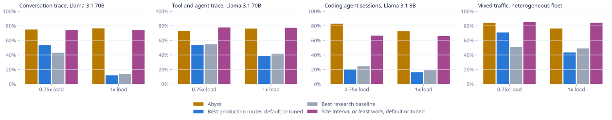
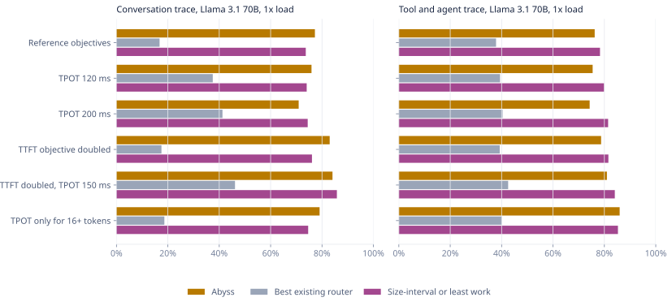
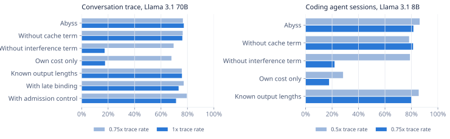
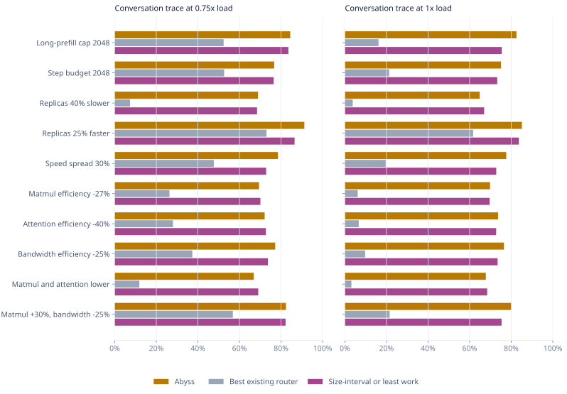
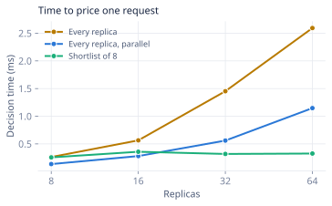
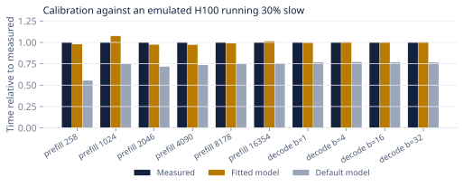

# Evaluation

Every table in this document is generated by `scripts/report.py` from the JSON files in `results/`, which `scripts/reproduce.sh` regenerates. Figures come from `scripts/plot.py`.

## Method

All policies run in the same discrete-event fleet simulator (`internal/cluster`). Replicas are instances of the engine model described in [design.md](design.md). Their real step times differ from Abyss's model in two ways the router never sees: a per-replica speed bias drawn uniformly from ±12% and per-step lognormal jitter with σ = 0.06. Policies observe the fleet only through the signals in section 6 of the design document. No policy knows output lengths.

Abyss's replica twin is the same engine code as the simulated replicas, so in the main experiments its model of each server is exact apart from the hidden bias and jitter. The robustness section adds model errors that change prefill and decode speed by different amounts, which a single speed factor cannot absorb.

Arrivals are open loop. A client abandons a request with no first token after `max(30 s, 4 × TTFT objective)`; abandoned requests free their memory and count as misses.

A request meets its objectives if its time to first token is within `base + per_k × prompt_tokens / 1000` and its mean time per output token is within a fixed bound:

| Preset | TTFT objective | TPOT objective |
|---|---|---|
| conversation-70b, toolagent-70b | 1.0 s + 0.15 s per 1k prompt tokens | 80 ms |
| agent-8b | 0.4 s + 0.03 s per 1k prompt tokens | 30 ms |
| mixed-hetero | 0.8 s + 0.08 s per 1k prompt tokens | 60 ms |

Loads are multiples of a reference rate. For the Mooncake traces it is the trace's own arrival rate replayed on the fleet in the table below; the fleet size is a choice of this evaluation, not the size of the fleet that served the trace. For the synthetic workloads it is the generator rate set in the preset. At the reference rate the existing routers already miss most objectives on every workload, so the evaluation also reports the load each policy sustains at a fixed attainment.

Each configuration runs on three independent inputs: three disjoint 20-minute windows of each Mooncake trace, or three generator seeds for synthetic workloads, each with its own noise seed. Attainment is the fraction of all arriving requests that complete within both objectives. Token-weighted attainment weights each request by its prompt length. Goodput counts requests meeting both objectives per second.

## Workloads

| Preset | Source | Requests per window | Reference rate | Mean prompt | p99 prompt | Mean output | Reusable prompt tokens | Fleet |
|---|---|---|---|---|---|---|---|---|
| conversation-70b | Mooncake FAST 2025 conversation trace | 3,658 | 3.05 req/s | 13,403 | 94,764 | 348 | 32% | 4 × H100 TP4, 96 GB host KV per GPU |
| toolagent-70b | Mooncake FAST 2025 tool and agent trace | 7,291 | 6.08 req/s | 9,219 | 74,072 | 183 | 53% | 4 × H100 TP4, 96 GB host KV per GPU |
| agent-8b | Synthetic coding agent sessions | 9,876 | 10.98 req/s | 34,736 | 85,008 | 231 | 93% | 8 × H100 |
| mixed-hetero | Synthetic chat, agent and RAG mix | 6,365 | 7.08 req/s | 13,492 | 76,415 | 263 | 89% | 2 × H100 TP2, 2 × A100 TP2, 2 × L40S TP4 |

## Baselines

| Policy | Implementation |
|---|---|
| llm-d scorer | Weighted prefix-match fraction (3), normalized queue length (2) and free KV fraction (2), the tuned weights reported by the llm-d project. Exact engine cache contents and gauges refreshed every engine step. |
| llm-d predicted latency | The decision rule of llm-d's predicted-latency scheduler: affinity gate at 80% prefix match, 1% exploration, affinity broken when the sticky replica's predicted TTFT is more than 5 s worse, 80/20 TTFT and TPOT headroom, best fit. Abyss's replica twin stands in for the trained latency model. |
| Dynamo KV router | Minimizes `overlap_weight × prefill_blocks + active_blocks` with weight 1 and temperature 0, with exact engine cache contents. |
| SGLang cache-aware | Per-worker approximate prefix tree; shortest queue when `max - min > 64` and `max > 1.5 × min`; otherwise best match above a 0.3 match ratio, else the smallest tree. |
| Preble-style | Preble's exploit or explore rule: send to the longest cached match when it covers more than half the prompt, otherwise to the replica with the lowest recent load plus prefill cost over a 60 s window. Preble's eviction term and local scheduler are not modeled. |
| Size-interval | Size-interval task assignment (Harchol-Balter et al., 1999). Prompts longer than a cutoff go to a dedicated pool made of the replicas with the slowest prefill, all other prompts to the remaining replicas. Inside each pool the request goes to the replica with the least outstanding work: prompt tokens of requests without a first token, a fixed 64 tokens per decoding request and the request's own uncached tokens, converted to seconds with each replica's prefill speed. Default cutoff 16,384 tokens with a quarter of the fleet in the long pool; exact engine cache contents. |
| Least work | The same work estimate without pools. |
| Bounded-load hashing | Consistent hashing on the first prompt block, 128 virtual nodes per replica, load bound 1.25 × mean. |
| Least request, round robin | Classic balancers on in-flight request counts. |
| Selfish twin | Abyss's replica twins and rollouts, scoring only the request's own cost. |

All baselines are reimplementations from public documentation, not the original software. In the tables, the existing routers are the llm-d scorer, llm-d predicted latency, Dynamo, SGLang, Preble-style, bounded-load hashing, least request and round robin; the heuristic is the better of size-interval and least work.

## Main results

With spare capacity the fixed cutoff is a handicap. At 0.25× the reference rate Abyss meets both objectives for 84% to 98% of requests, the size-interval heuristic with default parameters for 22% to 82%, and the best other policy for 78% to 95%.

### Mooncake conversation trace, Llama 3.1 70B

Share of requests meeting both latency targets, mean ± standard deviation over three runs, default parameters for every baseline.

| Policy | 0.25× (0.76 req/s) | 0.5× (1.52 req/s) | 0.75× (2.29 req/s) | 1× (3.05 req/s) | 1.25× (3.81 req/s) |
|---|---|---|---|---|---|
| Abyss | **91.1% ± 2.0** | **86.3% ± 1.7** | **76.6% ± 2.9** | **77.2% ± 1.4** | **76.1% ± 1.2** |
| Selfish twin | 89.1% ± 2.0 | 84.4% ± 3.2 | 67.9% ± 5.2 | 17.7% ± 2.7 | 12.6% ± 3.3 |
| llm-d predicted latency | 74.1% ± 1.0 | 65.6% ± 2.8 | 46.2% ± 5.5 | 16.8% ± 5.3 | 10.6% ± 1.6 |
| llm-d scorer | 64.0% ± 2.4 | 40.6% ± 3.7 | 31.2% ± 3.0 | 8.5% ± 3.6 | 0.1% ± 0.1 |
| Dynamo KV router | 79.9% ± 3.0 | 64.6% ± 3.1 | 45.9% ± 5.6 | 2.8% ± 2.2 | 0.2% ± 0.1 |
| SGLang cache-aware | 50.0% ± 3.0 | 33.1% ± 1.7 | 21.7% ± 0.9 | 10.6% ± 1.9 | 2.2% ± 1.9 |
| Preble-style | 73.0% ± 1.6 | 58.2% ± 6.1 | 25.6% ± 3.9 | 10.1% ± 3.5 | 0.2% ± 0.2 |
| Size-interval | 80.3% ± 1.8 | 73.6% ± 1.4 | 73.6% ± 1.4 | 73.7% ± 1.3 | 73.3% ± 1.0 |
| Least work | 85.9% ± 2.9 | 80.3% ± 3.4 | 62.9% ± 6.1 | 3.1% ± 3.8 | 0.2% ± 0.1 |
| Round robin | 76.8% ± 2.8 | 66.4% ± 3.0 | 39.0% ± 3.6 | 5.6% ± 4.3 | 0.7% ± 0.9 |
| Least request | 74.8% ± 3.1 | 63.2% ± 3.3 | 41.3% ± 4.6 | 2.6% ± 1.6 | 0.4% ± 0.2 |
| Bounded-load hashing | 64.7% ± 4.2 | 51.9% ± 4.6 | 26.0% ± 5.6 | 11.7% ± 0.6 | 9.2% ± 0.0 |

At 1× the reference rate:

| Policy | Goodput (req/s) | Token-weighted attainment | TTFT p50 | TTFT p99 | TPOT p50 | TPOT p99 | Cache hit rate | Abandoned | $ per M good tokens |
|---|---|---|---|---|---|---|---|---|---|
| Abyss | 2.63 | 58.6% | 1.06 s | 39.9 s | 39 ms | 352 ms | 23.2% | 8.2% | 11.99 |
| Selfish twin | 0.60 | 16.8% | 2.28 s | 29.7 s | 94 ms | 671 ms | 14.0% | 6.3% | 65.22 |
| llm-d predicted latency | 0.56 | 15.1% | 2.61 s | 29.5 s | 93 ms | 678 ms | 17.6% | 4.3% | 75.43 |
| llm-d scorer | 0.29 | 11.7% | 6.54 s | 28.3 s | 92 ms | 673 ms | 22.0% | 2.5% | 123.15 |
| Dynamo KV router | 0.09 | 3.8% | 14.0 s | 29.7 s | 105 ms | 620 ms | 16.7% | 3.1% | 6587.33 |
| SGLang cache-aware | 0.36 | 10.6% | 9.32 s | 31.3 s | 92 ms | 705 ms | 17.2% | 14.8% | 93.62 |
| Preble-style | 0.35 | 12.6% | 19.3 s | 35.4 s | 108 ms | 633 ms | 16.8% | 13.7% | 92.89 |
| Size-interval | 2.52 | 36.4% | 630 ms | 43.8 s | 23 ms | 244 ms | 24.8% | 19.4% | 13.04 |
| Least work | 0.11 | 4.0% | 14.6 s | 29.8 s | 105 ms | 615 ms | 16.5% | 3.7% | 3945.68 |
| Round robin | 0.18 | 5.3% | 17.5 s | 33.6 s | 109 ms | 642 ms | 10.2% | 12.2% | 525.75 |
| Least request | 0.09 | 2.5% | 15.4 s | 34.0 s | 111 ms | 610 ms | 9.3% | 12.1% | 1448.32 |
| Bounded-load hashing | 0.40 | 12.5% | 17.8 s | 37.2 s | 107 ms | 627 ms | 9.7% | 19.8% | 79.75 |

### Mooncake tool and agent trace, Llama 3.1 70B

Share of requests meeting both latency targets, mean ± standard deviation over three runs, default parameters for every baseline.

| Policy | 0.25× (1.52 req/s) | 0.5× (3.04 req/s) | 0.75× (4.56 req/s) | 1× (6.08 req/s) | 1.25× (7.59 req/s) |
|---|---|---|---|---|---|
| Abyss | **84.1% ± 1.1** | **80.3% ± 1.3** | **74.0% ± 1.6** | **76.2% ± 0.2** | **77.3% ± 1.0** |
| Selfish twin | 74.2% ± 1.4 | 70.2% ± 2.1 | 62.3% ± 4.5 | 25.6% ± 6.5 | 19.8% ± 0.8 |
| llm-d predicted latency | 53.7% ± 1.9 | 50.9% ± 3.1 | 43.8% ± 3.9 | 22.4% ± 2.5 | 12.0% ± 1.2 |
| llm-d scorer | 54.9% ± 3.5 | 33.9% ± 10.5 | 26.7% ± 8.4 | 14.1% ± 6.0 | 0.6% ± 0.4 |
| Dynamo KV router | 69.1% ± 1.9 | 59.2% ± 2.1 | 46.9% ± 3.1 | 13.9% ± 5.5 | 0.5% ± 0.4 |
| SGLang cache-aware | 54.8% ± 3.2 | 43.9% ± 1.6 | 33.7% ± 2.3 | 16.3% ± 0.5 | 2.7% ± 1.6 |
| Preble-style | 78.0% ± 1.2 | 69.2% ± 4.9 | 54.8% ± 2.0 | 37.8% ± 6.8 | 1.1% ± 0.9 |
| Size-interval | 81.5% ± 0.9 | 78.5% ± 1.1 | 78.6% ± 1.4 | 78.3% ± 1.7 | 77.7% ± 2.4 |
| Least work | 74.4% ± 2.0 | 70.4% ± 2.3 | 60.9% ± 3.8 | 19.2% ± 10.0 | 0.4% ± 0.2 |
| Round robin | 65.9% ± 1.4 | 58.5% ± 1.5 | 39.6% ± 2.1 | 15.7% ± 2.7 | 1.7% ± 0.9 |
| Least request | 65.3% ± 1.5 | 59.0% ± 1.2 | 44.3% ± 3.6 | 4.6% ± 1.8 | 0.9% ± 0.6 |
| Bounded-load hashing | 64.4% ± 3.4 | 54.1% ± 4.1 | 35.6% ± 4.7 | 21.1% ± 0.7 | 18.2% ± 1.4 |

At 1× the reference rate:

| Policy | Goodput (req/s) | Token-weighted attainment | TTFT p50 | TTFT p99 | TPOT p50 | TPOT p99 | Cache hit rate | Abandoned | $ per M good tokens |
|---|---|---|---|---|---|---|---|---|---|
| Abyss | 5.10 | 61.5% | 654 ms | 29.8 s | 31 ms | 678 ms | 52.4% | 3.8% | 11.61 |
| Selfish twin | 1.69 | 25.3% | 1.70 s | 28.5 s | 90 ms | 770 ms | 42.5% | 2.9% | 47.11 |
| llm-d predicted latency | 1.49 | 21.9% | 2.03 s | 26.8 s | 91 ms | 767 ms | 44.9% | 1.0% | 51.03 |
| llm-d scorer | 0.92 | 19.5% | 3.91 s | 25.0 s | 86 ms | 797 ms | 47.8% | 0.8% | 49.36 |
| Dynamo KV router | 0.93 | 16.6% | 4.65 s | 22.6 s | 92 ms | 752 ms | 44.3% | 0.3% | 79.69 |
| SGLang cache-aware | 1.09 | 16.2% | 5.69 s | 28.8 s | 89 ms | 754 ms | 44.8% | 3.6% | 67.62 |
| Preble-style | 2.56 | 27.7% | 4.69 s | 30.3 s | 59 ms | 630 ms | 47.3% | 12.0% | 83.08 |
| Size-interval | 5.23 | 53.1% | 613 ms | 29.7 s | 22 ms | 526 ms | 57.9% | 8.3% | 12.75 |
| Least work | 1.27 | 20.4% | 4.33 s | 22.1 s | 89 ms | 734 ms | 44.8% | 0.4% | 95.14 |
| Round robin | 1.05 | 15.0% | 11.1 s | 29.7 s | 96 ms | 746 ms | 39.8% | 9.6% | 61.50 |
| Least request | 0.30 | 4.6% | 11.2 s | 29.3 s | 104 ms | 724 ms | 39.3% | 4.7% | 429.53 |
| Bounded-load hashing | 1.41 | 18.7% | 9.64 s | 29.8 s | 92 ms | 712 ms | 41.9% | 11.1% | 74.75 |

### Coding agent sessions, Llama 3.1 8B

Share of requests meeting both latency targets, mean ± standard deviation over three runs, default parameters for every baseline.

| Policy | 0.25× (2.74 req/s) | 0.5× (5.49 req/s) | 0.75× (8.23 req/s) | 1× (10.98 req/s) |
|---|---|---|---|---|
| Abyss | **89.6% ± 2.1** | **86.2% ± 3.1** | **81.5% ± 2.7** | **71.3% ± 2.5** |
| Selfish twin | 84.5% ± 5.3 | 28.3% ± 11.9 | 17.7% ± 2.0 | 13.4% ± 2.2 |
| llm-d predicted latency | 67.4% ± 6.7 | 21.3% ± 12.0 | 8.8% ± 1.0 | 5.4% ± 2.0 |
| llm-d scorer | 81.4% ± 6.0 | 36.2% ± 24.6 | 18.1% ± 3.5 | 12.2% ± 1.2 |
| Dynamo KV router | 63.9% ± 7.8 | 15.1% ± 2.0 | 10.3% ± 1.7 | 7.9% ± 1.4 |
| SGLang cache-aware | 41.1% ± 4.9 | 24.8% ± 12.8 | 13.2% ± 4.2 | 10.1% ± 2.3 |
| Preble-style | 41.4% ± 5.4 | 28.5% ± 4.9 | 23.6% ± 3.1 | 17.9% ± 3.2 |
| Size-interval | 21.8% ± 1.7 | 20.5% ± 1.4 | 19.9% ± 1.4 | 19.4% ± 1.3 |
| Least work | 80.9% ± 6.2 | 19.6% ± 3.1 | 14.7% ± 1.5 | 11.3% ± 1.8 |
| Round robin | 42.8% ± 6.0 | 10.9% ± 1.7 | 7.6% ± 1.3 | 5.6% ± 0.6 |
| Least request | 42.6% ± 6.6 | 10.5% ± 1.5 | 7.4% ± 1.4 | 5.7% ± 0.8 |
| Bounded-load hashing | 42.5% ± 4.8 | 16.0% ± 2.6 | 12.6% ± 2.5 | 10.1% ± 2.0 |

At 1× the reference rate:

| Policy | Goodput (req/s) | Token-weighted attainment | TTFT p50 | TTFT p99 | TPOT p50 | TPOT p99 | Cache hit rate | Abandoned | $ per M good tokens |
|---|---|---|---|---|---|---|---|---|---|
| Abyss | 7.60 | 59.4% | 146 ms | 19.4 s | 25 ms | 171 ms | 89.2% | 17.2% | 3.12 |
| Selfish twin | 1.43 | 9.9% | 392 ms | 21.8 s | 74 ms | 167 ms | 75.3% | 25.0% | 16.82 |
| llm-d predicted latency | 0.57 | 4.1% | 2.18 s | 29.9 s | 86 ms | 331 ms | 74.6% | 38.9% | 44.36 |
| llm-d scorer | 1.30 | 9.2% | 24.2 s | 30.0 s | 91 ms | 275 ms | 77.5% | 40.9% | 18.89 |
| Dynamo KV router | 0.84 | 5.1% | 27.9 s | 30.0 s | 151 ms | 400 ms | 63.6% | 53.1% | 29.69 |
| SGLang cache-aware | 1.07 | 7.6% | 22.7 s | 30.0 s | 97 ms | 313 ms | 81.7% | 30.4% | 23.21 |
| Preble-style | 1.89 | 19.4% | 15.6 s | 30.0 s | 74 ms | 419 ms | 86.8% | 47.9% | 12.88 |
| Size-interval | 2.06 | 7.5% | 45 ms | 29.9 s | 9 ms | 396 ms | 84.6% | 77.2% | 11.95 |
| Least work | 1.20 | 7.8% | 28.3 s | 30.0 s | 157 ms | 434 ms | 69.5% | 51.1% | 20.39 |
| Round robin | 0.59 | 3.2% | 29.1 s | 30.0 s | 229 ms | 447 ms | 61.0% | 56.8% | 41.60 |
| Least request | 0.61 | 3.4% | 28.1 s | 30.0 s | 172 ms | 417 ms | 55.4% | 57.3% | 40.44 |
| Bounded-load hashing | 1.07 | 7.1% | 24.6 s | 30.0 s | 115 ms | 419 ms | 67.8% | 49.4% | 23.02 |

### Chat, agent and RAG mix, Qwen3 32B

Share of requests meeting both latency targets, mean ± standard deviation over three runs, default parameters for every baseline.

| Policy | 0.25× (1.77 req/s) | 0.5× (3.54 req/s) | 0.75× (5.31 req/s) | 1× (7.08 req/s) | 1.25× (8.85 req/s) | 1.5× (10.62 req/s) | 1.75× (12.39 req/s) |
|---|---|---|---|---|---|---|---|
| Abyss | **98.1% ± 0.4** | **94.7% ± 2.0** | **83.0% ± 2.6** | **78.0% ± 4.2** | **78.9% ± 9.0** | **79.6% ± 2.4** | **77.9% ± 3.1** |
| Selfish twin | 95.5% ± 0.1 | 84.1% ± 4.7 | 45.5% ± 5.7 | 16.8% ± 1.1 | 13.9% ± 1.0 | 10.4% ± 1.1 | 7.5% ± 0.9 |
| llm-d predicted latency | 79.7% ± 6.3 | 39.0% ± 1.6 | 19.4% ± 1.2 | 8.9% ± 2.5 | 5.4% ± 2.1 | 4.0% ± 0.4 | 3.2% ± 0.3 |
| llm-d scorer | 94.7% ± 0.5 | 86.1% ± 1.6 | 69.2% ± 3.3 | 26.1% ± 10.4 | 13.2% ± 3.3 | 10.7% ± 3.0 | 6.4% ± 1.6 |
| Dynamo KV router | 86.1% ± 2.8 | 37.5% ± 8.1 | 13.5% ± 3.5 | 8.2% ± 1.3 | 6.4% ± 1.9 | 4.8% ± 1.8 | 3.7% ± 1.2 |
| SGLang cache-aware | 80.8% ± 3.8 | 69.4% ± 2.0 | 54.5% ± 1.9 | 27.6% ± 5.4 | 17.8% ± 6.4 | 9.8% ± 1.8 | 6.6% ± 1.5 |
| Preble-style | 63.3% ± 18.8 | 49.0% ± 4.2 | 45.8% ± 8.8 | 43.6% ± 12.6 | 37.9% ± 15.8 | 27.3% ± 10.1 | 24.7% ± 10.2 |
| Size-interval | 74.5% ± 1.5 | 73.3% ± 1.8 | 73.0% ± 1.8 | 72.9% ± 1.8 | 72.9% ± 1.8 | 72.9% ± 1.8 | 72.8% ± 1.8 |
| Least work | 92.8% ± 2.0 | 68.9% ± 10.1 | 21.9% ± 8.9 | 10.8% ± 2.0 | 6.8% ± 1.8 | 5.2% ± 1.3 | 4.0% ± 1.3 |
| Round robin | 50.3% ± 1.9 | 21.9% ± 3.4 | 9.5% ± 2.4 | 6.4% ± 1.7 | 4.9% ± 1.1 | 3.4% ± 0.3 | 2.2% ± 0.3 |
| Least request | 62.8% ± 3.3 | 14.9% ± 2.2 | 8.5% ± 1.5 | 6.4% ± 1.5 | 4.4% ± 1.1 | 3.2% ± 1.3 | 2.6% ± 1.0 |
| Bounded-load hashing | 73.3% ± 9.9 | 44.0% ± 18.9 | 31.2% ± 15.7 | 28.1% ± 16.6 | 22.4% ± 12.8 | 19.8% ± 12.4 | 13.0% ± 6.6 |

At 1× the reference rate:

| Policy | Goodput (req/s) | Token-weighted attainment | TTFT p50 | TTFT p99 | TPOT p50 | TPOT p99 | Cache hit rate | Abandoned | $ per M good tokens |
|---|---|---|---|---|---|---|---|---|---|
| Abyss | 5.57 | 38.2% | 228 ms | 26.7 s | 43 ms | 293 ms | 77.2% | 13.7% | 4.04 |
| Selfish twin | 1.20 | 10.7% | 550 ms | 29.3 s | 117 ms | 508 ms | 71.2% | 12.6% | 21.71 |
| llm-d predicted latency | 0.64 | 8.8% | 896 ms | 29.7 s | 193 ms | 486 ms | 76.7% | 10.1% | 39.96 |
| llm-d scorer | 1.87 | 22.4% | 6.08 s | 28.6 s | 106 ms | 654 ms | 80.6% | 11.8% | 14.64 |
| Dynamo KV router | 0.59 | 6.1% | 22.9 s | 29.9 s | 172 ms | 1.47 s | 63.9% | 39.1% | 45.34 |
| SGLang cache-aware | 1.98 | 18.0% | 2.23 s | 29.6 s | 74 ms | 831 ms | 80.0% | 11.2% | 12.49 |
| Preble-style | 3.12 | 23.3% | 452 ms | 29.9 s | 39 ms | 855 ms | 76.2% | 31.8% | 7.79 |
| Size-interval | 5.21 | 20.6% | 70 ms | 7.12 s | 23 ms | 1.01 s | 65.7% | 25.7% | 4.30 |
| Least work | 0.77 | 6.0% | 25.2 s | 29.9 s | 281 ms | 815 ms | 65.0% | 33.0% | 33.82 |
| Round robin | 0.46 | 3.4% | 26.1 s | 30.0 s | 202 ms | 1.94 s | 53.7% | 44.3% | 59.98 |
| Least request | 0.46 | 3.3% | 25.5 s | 30.0 s | 215 ms | 1.38 s | 54.1% | 42.9% | 62.06 |
| Bounded-load hashing | 2.01 | 12.2% | 3.63 s | 29.8 s | 102 ms | 1.06 s | 68.6% | 26.2% | 15.19 |

## Load sustained at a fixed attainment

The highest load at which a policy still meets both objectives for at least 80% and 70% of requests, interpolated linearly between the tested loads, with default baseline parameters. "Below" means the policy misses the target at the lowest tested load; "or more" means it never fell below the target. Attainment is not always monotonic in load, so the value is the first crossing.

Measured as the highest load at which at least 80% of requests meet both objectives, Abyss sustains 0.66× (2.02 req/s) against 0.57× (1.73 req/s) for the selfish twin on the conversation trace; 0.51× (3.11 req/s) against 0.38× (2.30 req/s) for the size-interval heuristic on the tool and agent trace; 0.79× (8.64 req/s) against 0.27× (2.97 req/s) for the selfish twin on the coding agent sessions; 0.90× (6.37 req/s) against 0.59× (4.18 req/s) for the llm-d scorer on the mixed-GPU fleet. Loads are multiples of the reference rate, interpolated between the tested levels.

| Workload | Policy | Load at 80% attainment | Load at 70% attainment |
|---|---|---|---|
| Conversation trace | **Abyss** | 0.66× (2.02 req/s) | 1.25× or more |
| Conversation trace | Selfish twin | 0.57× (1.73 req/s) | 0.72× (2.19 req/s) |
| Conversation trace | llm-d predicted latency | below 0.25× | 0.37× (1.13 req/s) |
| Conversation trace | llm-d scorer | below 0.25× | below 0.25× |
| Conversation trace | Dynamo KV router | below 0.25× | 0.41× (1.26 req/s) |
| Conversation trace | Preble-style | below 0.25× | 0.30× (0.92 req/s) |
| Conversation trace | Size-interval | 0.26× (0.80 req/s) | 1.25× or more |
| Conversation trace | Least work | 0.50× (1.54 req/s) | 0.65× (1.98 req/s) |
| Conversation trace | Round robin | below 0.25× | 0.41× (1.26 req/s) |
| Tool and agent trace | **Abyss** | 0.51× (3.11 req/s) | 1.25× or more |
| Tool and agent trace | Selfish twin | below 0.25× | 0.51× (3.08 req/s) |
| Tool and agent trace | llm-d predicted latency | below 0.25× | below 0.25× |
| Tool and agent trace | llm-d scorer | below 0.25× | below 0.25× |
| Tool and agent trace | Dynamo KV router | below 0.25× | below 0.25× |
| Tool and agent trace | Preble-style | below 0.25× | 0.48× (2.91 req/s) |
| Tool and agent trace | Size-interval | 0.38× (2.30 req/s) | 1.25× or more |
| Tool and agent trace | Least work | below 0.25× | 0.51× (3.11 req/s) |
| Tool and agent trace | Round robin | below 0.25× | below 0.25× |
| Coding agent sessions | **Abyss** | 0.79× (8.64 req/s) | 1× or more |
| Coding agent sessions | Selfish twin | 0.27× (2.97 req/s) | 0.31× (3.45 req/s) |
| Coding agent sessions | llm-d predicted latency | below 0.25× | below 0.25× |
| Coding agent sessions | llm-d scorer | 0.26× (2.83 req/s) | 0.31× (3.43 req/s) |
| Coding agent sessions | Dynamo KV router | below 0.25× | below 0.25× |
| Coding agent sessions | Preble-style | below 0.25× | below 0.25× |
| Coding agent sessions | Size-interval | below 0.25× | below 0.25× |
| Coding agent sessions | Least work | 0.25× (2.79 req/s) | 0.29× (3.23 req/s) |
| Coding agent sessions | Round robin | below 0.25× | below 0.25× |
| Mixed traffic, mixed GPUs | **Abyss** | 0.90× (6.37 req/s) | 1.75× or more |
| Mixed traffic, mixed GPUs | Selfish twin | 0.53× (3.73 req/s) | 0.59× (4.19 req/s) |
| Mixed traffic, mixed GPUs | llm-d predicted latency | below 0.25× | 0.31× (2.19 req/s) |
| Mixed traffic, mixed GPUs | llm-d scorer | 0.59× (4.18 req/s) | 0.74× (5.23 req/s) |
| Mixed traffic, mixed GPUs | Dynamo KV router | 0.28× (1.99 req/s) | 0.33× (2.35 req/s) |
| Mixed traffic, mixed GPUs | Preble-style | below 0.25× | below 0.25× |
| Mixed traffic, mixed GPUs | Size-interval | below 0.25× | 1.75× or more |
| Mixed traffic, mixed GPUs | Least work | 0.38× (2.72 req/s) | 0.49× (3.46 req/s) |
| Mixed traffic, mixed GPUs | Round robin | below 0.25× | below 0.25× |

## Baselines tuned on held-out data

Default parameters can be unfair to a baseline. For each workload, every family's parameters were grid searched on one trace window or seed (95 settings for llm-d, 80 for SGLang, 7 for Dynamo, 6 for bounded-load hashing and 60 for the size-interval heuristic), choosing the setting with the highest mean attainment across the two load levels. All policies were then evaluated on the other two windows or seeds. The tables report, per family, whichever of default and tuned did better on the held-out data, which favors the baselines.

Against the best existing router on each workload, Abyss is ahead by 27 to 62 points at the reference rate. The strongest alternative is the size-interval heuristic, which sends every prompt above a length cutoff to dedicated replicas: Abyss is ahead by 2 points on the conversation trace, behind by 1 point on the tool and agent trace, ahead by 7 points on the coding agent sessions and behind by 8 points on the mixed-GPU fleet. The heuristic gives up on nearly every prompt above its cutoff; weighted by prompt tokens, Abyss is ahead of it on three of four workloads (the conversation trace, the tool and agent trace and the coding agent sessions).

#### Mooncake conversation trace, Llama 3.1 70B

Parameters chosen on the tuning window: chwbl `chwbl:1.1`, dynamo `dynamo:8`, llm-d `llm-d:8,2,0`, sglang `sglang:0.1,8,1.05`, sita `sita:32768,1`.

| Load | Abyss | Selfish twin | Best production router | Best research baseline | Size-interval or least work | Abyss, token-weighted | Heuristic, token-weighted |
|---|---|---|---|---|---|---|---|
| 0.75× | **74.9% ± 0.5** | 65.0% | 53.7% ± 2.7 (llm-d scorer (8, 2, 0)) | 43.0% ± 0.4 (llm-d predicted latency) | 74.3% ± 0.6 (Size-interval) | 68.7% | 38.5% |
| 1× | **76.4% ± 0.3** | 16.2% | 12.0% ± 0.3 (Bounded-load hashing) | 14.0% ± 3.5 (llm-d predicted latency) | 74.4% ± 0.5 (Size-interval) | 57.9% | 38.5% |

#### Mooncake tool and agent trace, Llama 3.1 70B

Parameters chosen on the tuning window: chwbl `chwbl:3`, dynamo `dynamo:8`, llm-d `llm-d:2,1,0`, sglang `sglang:0.1,8,1.25`, sita `sita:16384,1`.

| Load | Abyss | Selfish twin | Best production router | Best research baseline | Size-interval or least work | Abyss, token-weighted | Heuristic, token-weighted |
|---|---|---|---|---|---|---|---|
| 0.75× | 73.1% ± 0.1 | 60.5% | 53.8% ± 3.4 (llm-d scorer (2, 1, 0)) | 54.6% ± 2.7 (Preble-style) | **77.8% ± 0.7** (Size-interval) | 68.8% | 54.6% |
| 1× | 76.3% ± 0.2 | 21.9% | 38.6% ± 2.8 (Bounded-load hashing (3)) | 41.7% ± 2.3 (Preble-style) | **77.3% ± 0.3** (Size-interval) | 61.6% | 54.3% |

#### Coding agent sessions, Llama 3.1 8B

Parameters chosen on the tuning window: chwbl `chwbl:1.5`, dynamo `dynamo:8`, llm-d `llm-d:8,0,1`, sglang `sglang:0.1,8,2`, sita `sita:40960,1`.

| Load | Abyss | Selfish twin | Best production router | Best research baseline | Size-interval or least work | Abyss, token-weighted | Heuristic, token-weighted |
|---|---|---|---|---|---|---|---|
| 0.75× | **83.0% ± 0.4** | 17.8% | 20.6% ± 4.4 (Dynamo KV router (8)) | 24.6% ± 3.6 (Preble-style) | 66.6% ± 1.6 (Size-interval (40k cutoff, 1 long replica)) | 73.0% | 45.1% |
| 1× | **72.6% ± 1.7** | 13.7% | 16.2% ± 3.2 (Dynamo KV router (8)) | 19.0% ± 3.4 (Preble-style) | 65.9% ± 1.8 (Size-interval (40k cutoff, 1 long replica)) | 60.2% | 44.5% |

#### Chat, agent and RAG mix, Qwen3 32B

Parameters chosen on the tuning window: chwbl `chwbl:2`, dynamo `dynamo:8`, llm-d `llm-d:8,1,0`, sglang `sglang:0.1,32,1.05`, sita `sita:32768,1`.

| Load | Abyss | Selfish twin | Best production router | Best research baseline | Size-interval or least work | Abyss, token-weighted | Heuristic, token-weighted |
|---|---|---|---|---|---|---|---|
| 0.75× | 84.0% ± 2.9 | 46.1% | 70.9% ± 2.1 (llm-d scorer) | 50.7% ± 3.6 (Preble-style) | **85.1% ± 1.7** (Size-interval (32k cutoff, 1 long replica)) | 52.2% | 43.7% |
| 1× | 76.3% ± 4.3 | 17.3% | 43.5% ± 16.2 (Bounded-load hashing (2)) | 49.0% ± 11.9 (Preble-style) | **84.2% ± 1.2** (Size-interval (32k cutoff, 1 long replica)) | 34.9% | 43.2% |

## Sensitivity to the latency objectives

The production traces rerun with looser objectives, and with the TPOT objective applied only to responses of at least 16 tokens. A single long prefill step can push the mean TPOT of a very short response past its objective, so the last variant measures how much of the result depends on such responses. The size-interval column is the best of five settings in hindsight (default, tuned on the reference objectives, two fixed cutoffs, and least work), which favors the heuristic.

The comparison depends on the latency objectives. Across six variants of the objectives on the two production traces at the reference rate, Abyss's difference from the best existing router ranges from +30 to +65 points, and from the best size-interval setting from -7 to +7 points.

#### Mooncake conversation trace, Llama 3.1 70B

| Objectives | Load | Abyss | Selfish twin | Best existing router | Best size-interval or least-work setting |
|---|---|---|---|---|---|
| Reference: TTFT 1 s + 0.15 s per 1k tokens, TPOT 80 ms | 0.5× | **86.3%** | 84.4% | 66.4% (Round robin) | 80.3% (Least work) |
|  | 1× | **77.2%** | 17.7% | 16.8% (llm-d predicted latency) | 73.7% (Size-interval) |
| TPOT 120 ms | 0.5× | **88.0%** | 86.7% | 72.5% (llm-d predicted latency) | 82.1% (Least work) |
|  | 1× | **75.9%** | 40.1% | 37.5% (llm-d predicted latency) | 74.0% (Size-interval) |
| TPOT 200 ms | 0.5× | **89.7%** | 86.9% | 74.2% (llm-d predicted latency) | 83.4% (Least work) |
|  | 1× | 70.9% | 47.4% | 41.3% (llm-d predicted latency) | **74.4%** (Size-interval) |
| TTFT 2 s + 0.3 s per 1k tokens | 0.5× | **93.2%** | 92.1% | 82.9% (Dynamo KV router) | 90.9% (Least work) |
|  | 1× | **83.0%** | 17.1% | 17.5% (llm-d predicted latency) | 76.1% (Size-interval) |
| TTFT 2 s + 0.3 s per 1k tokens, TPOT 150 ms | 0.5× | **95.9%** | 95.5% | 86.2% (Dynamo KV router) | 93.8% (Least work) |
|  | 1× | 84.1% | 52.3% | 46.1% (llm-d predicted latency) | **85.8%** (Size-interval (32k cutoff, 1 long replica)) |
| TPOT objective only for responses of 16 tokens or more | 0.5× | **88.5%** | 86.7% | 68.7% (llm-d predicted latency) | 82.8% (Least work) |
|  | 1× | **79.1%** | 19.6% | 18.6% (llm-d predicted latency) | 74.6% (Size-interval) |

#### Mooncake tool and agent trace, Llama 3.1 70B

| Objectives | Load | Abyss | Selfish twin | Best existing router | Best size-interval or least-work setting |
|---|---|---|---|---|---|
| Reference: TTFT 1 s + 0.15 s per 1k tokens, TPOT 80 ms | 0.5× | **80.3%** | 70.2% | 69.2% (Preble-style) | 78.5% (Size-interval) |
|  | 1× | 76.2% | 25.6% | 37.8% (Preble-style) | **78.3%** (Size-interval) |
| TPOT 120 ms | 0.5× | **83.3%** | 75.4% | 72.5% (Preble-style) | 80.1% (Size-interval) |
|  | 1× | 75.4% | 40.6% | 39.4% (Preble-style) | **79.9%** (Size-interval) |
| TPOT 200 ms | 0.5× | **86.3%** | 78.6% | 74.7% (Preble-style) | 82.0% (Size-interval) |
|  | 1× | 74.3% | 44.0% | 40.4% (Preble-style) | **81.5%** (Size-interval) |
| TTFT 2 s + 0.3 s per 1k tokens | 0.5× | **82.0%** | 75.2% | 74.9% (Preble-style) | 81.8% (Size-interval) |
|  | 1× | 78.7% | 27.5% | 39.3% (Preble-style) | **81.6%** (Size-interval) |
| TTFT 2 s + 0.3 s per 1k tokens, TPOT 150 ms | 0.5× | **86.8%** | 83.7% | 80.9% (Preble-style) | 86.5% (Size-interval (32k cutoff, 1 long replica)) |
|  | 1× | 81.0% | 46.3% | 42.5% (Preble-style) | **84.1%** (Size-interval) |
| TPOT objective only for responses of 16 tokens or more | 0.5× | **89.7%** | 84.5% | 72.6% (Preble-style) | 85.6% (Size-interval) |
|  | 1× | **86.0%** | 35.9% | 40.1% (Preble-style) | 85.3% (Size-interval) |

## Ablations

#### Mooncake conversation trace, Llama 3.1 70B

| Variant | 0.75× | 1× |
|---|---|---|
| Abyss | 76.6% ± 2.9 | 77.2% ± 1.4 |
| Without interference term | 69.5% ± 5.1 | 17.4% ± 4.7 |
| Without cache term | 76.4% ± 2.2 | 76.1% ± 1.4 |
| Selfish twin | 67.9% ± 5.2 | 17.7% ± 2.7 |
| Known output lengths | 75.7% ± 2.9 | 75.8% ± 0.8 |
| With late binding | 77.2% ± 1.9 | 73.3% ± 2.9 |
| With admission control | 79.6% ± 2.1 | 71.4% ± 3.2 |

#### Coding agent sessions, Llama 3.1 8B

| Variant | 0.5× | 0.75× |
|---|---|---|
| Abyss | 86.2% ± 3.1 | 81.5% ± 2.7 |
| Without interference term | 78.9% ± 4.9 | 21.9% ± 2.7 |
| Without cache term | 78.3% ± 0.8 | 81.3% ± 1.0 |
| Selfish twin | 28.3% ± 11.9 | 17.7% ± 2.0 |
| Known output lengths | 85.5% ± 3.4 | 80.1% ± 1.7 |

Removing the interference term on the conversation trace at the reference rate lowers attainment from 77.2% to 17.4%.

## Robustness

The conversation trace rerun with different engine settings, with replicas whose real speed differs uniformly from Abyss's model, and with model errors that change prefill and decode speed by different amounts, three windows each. Existing is the strongest of llm-d predicted latency, the llm-d scorer, Dynamo and Preble-style; the heuristic is the best of size-interval (default and tuned on the reference conditions) and least work.

Abyss's replica model is the same code as the simulated servers. When the servers' real prefill or decode speed departs from the model in ways a single speed factor cannot absorb, Abyss's attainment on the conversation trace at the reference rate ranges from 67.8% to 80.2% (77.2% with an exact model), its median TTFT prediction error stays between 13% and 15%, and its difference from the size-interval heuristic ranges from -1 to +5 points.

| Condition | Abyss, 0.75× | Existing, 0.75× | Heuristic, 0.75× | Abyss, 1× | Existing, 1× | Heuristic, 1× | Abyss TTFT error, 1× |
|---|---|---|---|---|---|---|---|
| *Engine settings* | | | | | | | |
| vLLM long-prefill cap of 2048 tokens | 84.4% | 52.4% (Dynamo KV router) | 83.5% (Size-interval (32k cutoff, 1 long replica)) | 82.5% | 16.2% (llm-d predicted latency) | 75.5% (Size-interval) | 22% |
| Step budget of 2048 tokens instead of 8192 | 76.7% | 52.6% (llm-d predicted latency) | 76.4% (Size-interval (32k cutoff, 1 long replica)) | 75.1% | 21.3% (llm-d predicted latency) | 73.3% (Size-interval) | 6% |
| *Uniform speed error* | | | | | | | |
| Every replica 40% slower than modeled | 68.9% | 7.4% (llm-d predicted latency) | 68.5% (Size-interval) | 64.8% | 3.8% (llm-d predicted latency) | 67.0% (Size-interval) | 13% |
| Every replica 25% faster than modeled | 91.2% | 73.0% (Dynamo KV router) | 86.5% (Least work) | 85.1% | 61.7% (llm-d predicted latency) | 83.7% (Size-interval (32k cutoff, 1 long replica)) | 13% |
| Hidden per-replica speed spread of ±30% instead of ±12% | 78.5% | 47.7% (Dynamo KV router) | 72.8% (Size-interval) | 77.6% | 19.6% (llm-d predicted latency) | 72.8% (Size-interval) | 14% |
| *Model error that one speed factor cannot absorb* | | | | | | | |
| Matrix-multiply efficiency 27% below the model | 69.4% | 26.3% (llm-d predicted latency) | 70.1% (Size-interval) | 69.8% | 6.2% (llm-d predicted latency) | 69.6% (Size-interval) | 14% |
| Attention efficiency 40% below the model | 72.1% | 28.0% (llm-d predicted latency) | 72.7% (Size-interval) | 73.7% | 6.7% (llm-d predicted latency) | 72.7% (Size-interval) | 15% |
| Memory-bandwidth efficiency 25% below the model | 77.2% | 37.3% (Dynamo KV router) | 73.7% (Size-interval (32k cutoff, 1 long replica)) | 76.5% | 9.8% (llm-d predicted latency) | 73.5% (Size-interval) | 13% |
| Matrix-multiply and attention efficiency both below the model | 66.8% | 11.9% (llm-d predicted latency) | 69.0% (Size-interval) | 67.8% | 3.1% (llm-d predicted latency) | 68.4% (Size-interval) | 14% |
| Matrix multiplies 30% faster, memory bandwidth 25% slower | 82.3% | 56.8% (Dynamo KV router) | 82.2% (Size-interval (32k cutoff, 1 long replica)) | 80.2% | 21.5% (llm-d predicted latency) | 75.4% (Size-interval) | 14% |

## Fleet size and decision time

Mixed traffic on 8 to 64 Llama 3.1 8B replicas with offered load proportional to fleet size, one 300 s run per size. The shortlist variant prices only the 8 replicas with the lowest estimated backlog, plus the replica with the longest cached prefix.

Pricing every replica keeps attainment between 98.6% and 99.6% from 8 to 64 replicas, while the best of llm-d, Dynamo, Preble-style and the size-interval heuristic goes from 90.6% to 78.8%. The shortlist of 8 reaches 99.6% at 8, 99.1% at 16, 94.8% at 32, 84.6% at 64 replicas: it matches full pricing on small fleets but loses quality on large ones, so at scale parallel pricing is the better way to bound decision time.

| Replicas | Offered load | Abyss | Abyss, shortlist of 8 | llm-d scorer | Dynamo KV router | Preble-style | Size-interval |
|---|---|---|---|---|---|---|---|
| 8 | 14.1 req/s | 99.6% | 99.6% | 90.6% | 73.7% | 84.4% | 81.8% |
| 16 | 29.1 req/s | 99.1% | 99.1% | 92.3% | 51.7% | 72.9% | 79.0% |
| 32 | 56.9 req/s | 99.5% | 94.8% | 85.5% | 53.6% | 74.7% | 79.4% |
| 64 | 117.6 req/s | 98.6% | 84.6% | 78.8% | 44.9% | 67.0% | 75.8% |

Decision time per request, measured with Go's benchmark harness on AMD Ryzen 3 3250U with Radeon Graphics:

| Replicas | Every replica | Every replica, parallel | Shortlist of 8 |
|---|---|---|---|
| 8 | 0.26 ms | 0.14 ms | 0.26 ms |
| 16 | 0.56 ms | 0.28 ms | 0.36 ms |
| 32 | 1.45 ms | 0.56 ms | 0.32 ms |
| 64 | 2.59 ms | 1.15 ms | 0.33 ms |

## Where the gain comes from

In the first window of the conversation trace at the reference rate, round robin gives every replica a share of decode tokens within 1% of its share of prefill tokens. Under Abyss one replica processes 27% of all prefill tokens but only 5% of decode tokens. No rule asks for this; it follows from pricing the stall a long prefill imposes on running decodes. The size-interval heuristic produces the split by rule: its long-prompt replica processes 40% of prefill tokens and 4% of decode tokens. The difference is that Abyss still places long prompts on the other replicas when they have room, while the heuristic never does, which costs the heuristic attainment at low load and on long prompts.

## Who pays

Attainment by prompt length in the first window at the reference rate. Conversation trace:

| Policy | <4k tokens (1,131) | 4k-16k tokens (1,567) | 16k-64k tokens (846) | >64k tokens (114) |
|---|---|---|---|---|
| Abyss | 80% | 86% | 73% | 4% |
| Selfish twin | 21% | 20% | 21% | 18% |
| llm-d predicted latency | 25% | 22% | 21% | 13% |
| llm-d scorer | 8% | 10% | 17% | 20% |
| Dynamo KV router | 2% | 3% | 5% | 10% |
| Preble-style | 6% | 11% | 12% | 18% |
| Size-interval | 97% | 99% | 0% | 0% |
| Least work | 1% | 2% | 2% | 7% |
| Round robin | 9% | 11% | 11% | 6% |

Coding agent sessions:

| Policy | 4k-16k tokens (1,855) | 16k-64k tokens (7,236) | >64k tokens (785) |
|---|---|---|---|
| Abyss | 87% | 69% | 22% |
| Selfish twin | 21% | 12% | 2% |
| llm-d predicted latency | 7% | 4% | 0% |
| llm-d scorer | 21% | 11% | 3% |
| Dynamo KV router | 15% | 8% | 0% |
| Preble-style | 16% | 15% | 23% |
| Size-interval | 100% | 1% | 0% |
| Least work | 19% | 10% | 1% |
| Round robin | 13% | 5% | 0% |

Abyss maximizes the number of requests that meet their objectives, and the longest prompts are the most expensive to serve, so they gain the least. The size-interval heuristic goes further and gives up on almost every prompt above its cutoff. Operators can raise the weight of a request class with the `X-Abyss-Weight` header.

## Prediction quality

| Workload | Median relative TTFT prediction error | Mean decision time (simulation) |
|---|---|---|
| Mooncake conversation trace, Llama 3.1 70B | 7% to 13% | 0.10 to 0.32 ms |
| Mooncake tool and agent trace, Llama 3.1 70B | 17% to 23% | 0.08 to 0.25 ms |
| Coding agent sessions, Llama 3.1 8B | 8% to 11% | 1.28 to 1.48 ms |
| Chat, agent and RAG mix, Qwen3 32B | 11% to 14% | 0.35 to 0.66 ms |

Prediction error is measured against the real first token of each dispatched request, under hidden speed bias and jitter, unknown output lengths and future arrivals. The robustness table gives the error under model mismatch.

## Calibration

`abyss calibrate` against an emulated H100 configured to run 30% slower than its model. The default model's median error is 25.0%; after fitting it is 1.4% (maximum 7.5%). The emulator uses the same model family, so this verifies the measurement and fitting procedure, not the model's fidelity to real GPUs.

| Measurement | Measured | Fitted model | Default model |
|---|---|---|---|
| Prefill, 258 tokens | 17.9 ms | 17.5 ms | 9.9 ms |
| Prefill, 1,024 tokens | 37.4 ms | 40.2 ms | 28.0 ms |
| Prefill, 2,046 tokens | 74.2 ms | 72.2 ms | 53.2 ms |
| Prefill, 4,090 tokens | 146.4 ms | 142.3 ms | 107.7 ms |
| Prefill, 8,178 tokens | 309.7 ms | 306.7 ms | 232.4 ms |
| Prefill, 16,354 tokens | 725.5 ms | 735.9 ms | 549.1 ms |
| Decode step, batch 1 | 10.2 ms | 10.2 ms | 7.8 ms |
| Decode step, batch 4 | 10.3 ms | 10.3 ms | 8.0 ms |
| Decode step, batch 16 | 11.0 ms | 11.0 ms | 8.4 ms |
| Decode step, batch 32 | 11.9 ms | 11.9 ms | 9.1 ms |

## Limitations

- Simulation: the main results come from a simulator. The engine model follows vLLM V1 scheduling and the step-time model uses published accelerator specifications with assumed efficiencies, but it has not been validated against real GPUs. `scripts/gpu/` contains the procedure to do so.
- Exact replica model: Abyss's twin and the simulated replicas share code, so structural differences between the twin and a real engine (scheduler details, kernels whose cost does not follow the roofline model) are not represented. The model-error rows in the robustness section cover speed errors only.
- Reimplemented baselines: they follow public documentation and either default or held-out tuned parameters, not the original code.
- Operating point and objectives: at the reference rate the existing routers miss most objectives, and the size of Abyss's lead depends on the objectives, as the sensitivity section shows.
- Request-count objective: optimizing the number of requests that meet their objectives favors short requests, as the length tables show.
- Prompt identity in the gateway: hashing rendered prompt bytes instead of tokens is approximate and affects every cache-aware policy.
- Tail latency under overload: Abyss concentrates the cost of overload on few requests, which reach the client abandonment limit.
